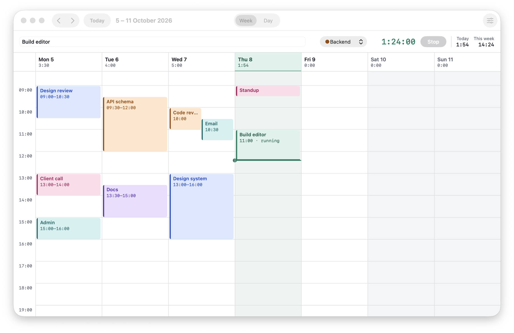
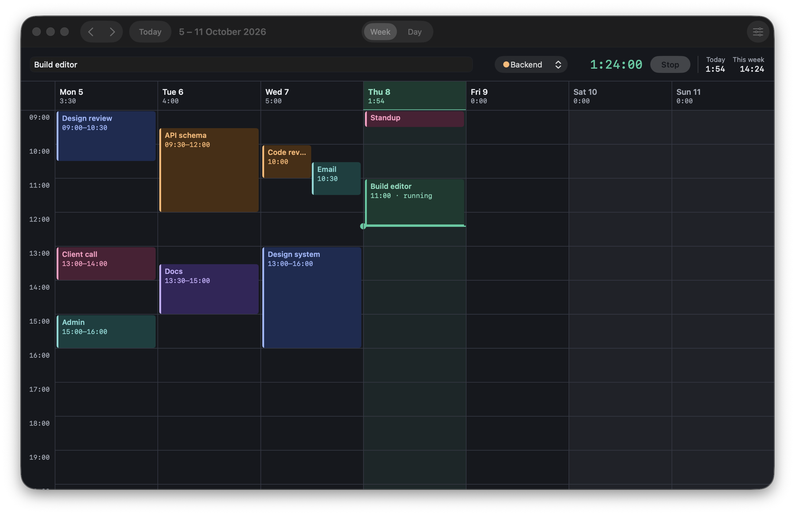
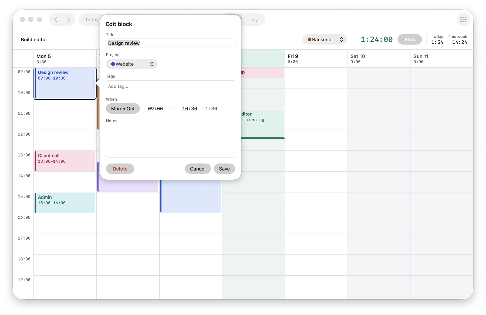
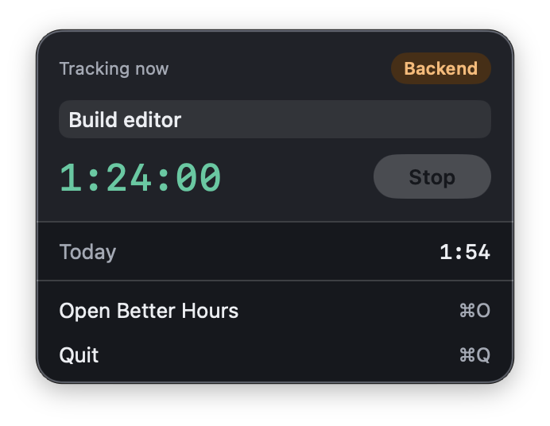
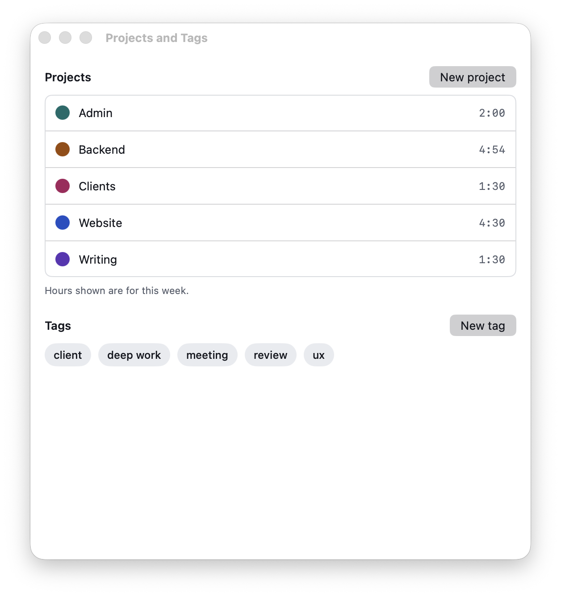

# Better Hours

Better Hours is a native macOS time tracker. You block time on a week or day calendar, or start a timer from the main window or the menubar, and tag the time with projects and tags.





| Block editor | Menubar popover | Projects and tags |
|---|---|---|
|  |  |  |

The screenshots show sample data from the app's debug demo mode (`-demo` launch argument).

## Status

Phase 1: the Mac app, local only. There is no account, no network access, and no sync yet. The design is in `specs/`.

## Requirements

- macOS 14 or later
- Xcode 26
- [XcodeGen](https://github.com/yonaskolb/XcodeGen) (`brew install xcodegen`)

## Build and run from source

```sh
cd apps/mac
xcodegen generate
open BetterHours.xcodeproj
```

Then run the `BetterHours` scheme in Xcode. From the command line, `xcodebuild -scheme BetterHours -destination 'platform=macOS' build` builds it. The `.xcodeproj` is generated and not committed.

## Tests

```sh
cd apps/mac/Packages/BetterHoursCore && swift test
cd apps/mac && xcodegen generate && xcodebuild -scheme BetterHours -destination 'platform=macOS' test
```

The first runs the core package, including every fixture in `fixtures/`. The second runs the app's model and view tests.

## Release build

```sh
apps/mac/scripts/build-release.sh
```

This generates the project, builds the Release configuration with ad-hoc signing, and zips the app to `apps/mac/build/BetterHours-<version>.zip`. It prints the path of the zip when it succeeds and exits non-zero on any error.

## Where the data lives

`~/Library/Application Support/Better Hours/betterhours.sqlite`. Delete the file to start over.

## Opening an unsigned build

The release build is ad-hoc signed, not notarized, so Gatekeeper blocks it the first time. Right-click `Better Hours.app` and choose Open, then confirm. Or try to open it once, then go to System Settings, Privacy & Security, and click Open Anyway.
